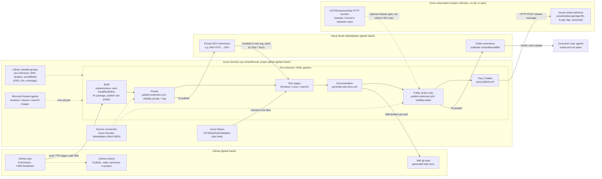
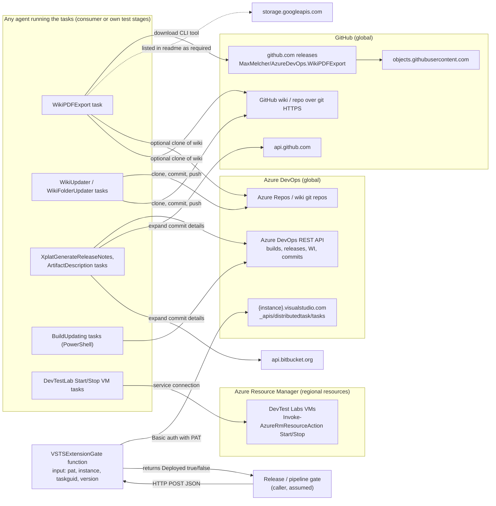
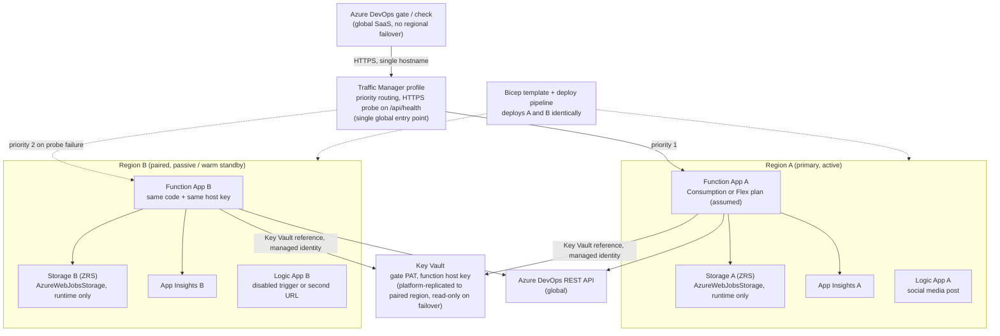
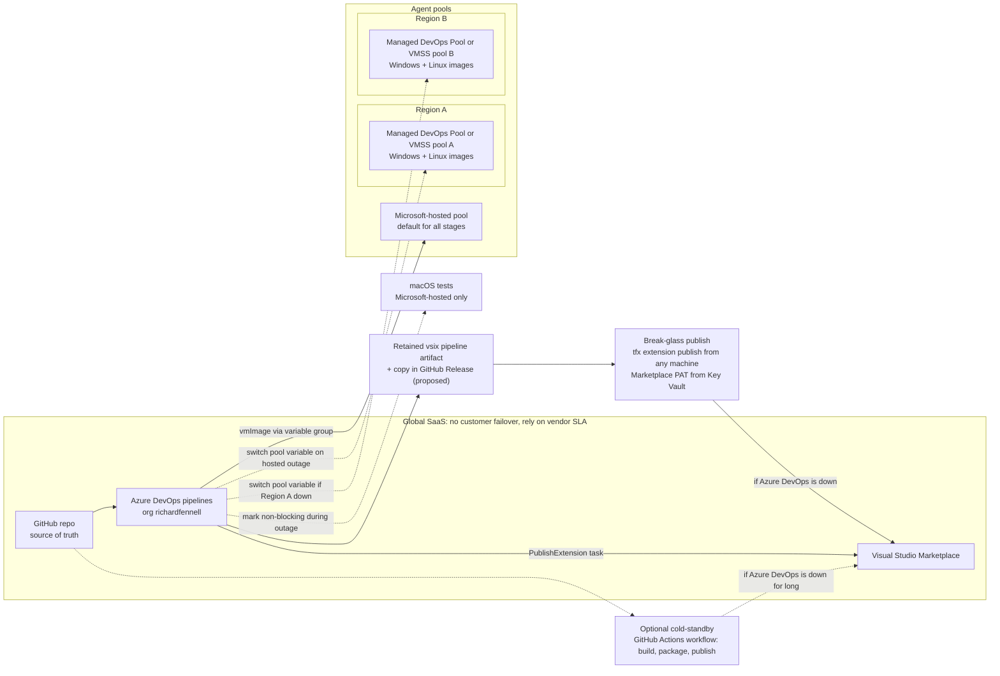

# Infrastructure and secondary-region design

> Scope: the Azure DevOps Pipelines extensions in `Extensions/`, the build/publish pipelines that ship them, the `AzureFunctions/VSTSExtensionGate` sample and the external services the tasks call at run time.
> Status: **proposal** for review. Nothing here has been deployed. The repo has **no infrastructure-as-code**, so anything about Azure resources (regions, SKUs, hosting plans, names) is an **assumption** and is marked as one.

## 1. Summary

- **What the repo ships.** Each folder under `Extensions/` is a Visual Studio Marketplace extension (publisher `richardfennellBM`). Tasks are TypeScript (npm, tsc, mocha) or PowerShell. They are packaged into `.vsix` files with `tfx` and published by one Azure DevOps YAML pipeline per extension (`Extensions/*/azure-pipelines-build.yml` or `azure-pipelines.yml`). The pipelines use the shared templates in `YAMLTemplates/`.
- **Where it runs.** CI/CD runs in Azure DevOps (org `richardfennell`, project `github`, per the README badges) on **Microsoft-hosted agents**. The source of truth is this GitHub repo. Releases go to the Marketplace in two steps: first as a **private, tagged DEV extension**, which is installed and tested in the publisher's own org, and then, from `main` only, as the **public** extension. After that the pipeline posts a release note to a social-media webhook.
- **Hosted compute.** The only Azure compute is the `VSTSExtensionGate` HTTP function. It is a stateless C# script that asks an Azure DevOps org whether a given task version has been installed yet, so it works as a release gate. Its readme says the code **has moved to its own repo** (`rfennell/AzureDevOpsExtensionGate`), and **no pipeline in this repo calls it**. The social-media endpoint (`socialmediaLogicAppURL`) is a second Azure component that is probably regional (assumed to be a Logic App).
- **What can fail over.** Most of the system is global SaaS: GitHub, Azure DevOps and the Marketplace. None of it has a customer-controlled regional failover. Only the gate function, its storage and secrets, the social-media endpoint and the **build agents** can be made multi-region.
- **Recommendation.** Run the gate **active-passive** in two paired regions behind Traffic Manager (priority routing), with one Bicep template deploying both. Add a **self-hosted / Managed DevOps Pool in a second region** as a fallback for the Windows and Linux stages. Keep the **`.vsix` artifact and a scripted `tfx` publish** as the break-glass path to the Marketplace. Before spending anything, first confirm the gate is still used (see open questions). If it is not, retiring it, or replacing it with a direct REST check, removes the only regional dependency.

## 2. Diagram 1 — current state

### 1a. CI/CD flow (from `azure-pipelines-build.yml` + `YAMLTemplates/`)

### 1b. Run-time dependencies: what the shipped tasks and the gate call

## 3. Diagram 2 — proposed secondary-region deployment

Region names are placeholders: **Region A** is the primary region and **Region B** is its Azure paired region. Choose them where the Azure DevOps org's data lives (open question Q3).

### 2a. Gate function (and the social-media webhook) in two regions

### 2b. Keeping the build and publish path working

**How the pipeline keeps working:**

1. **Agent outage (Microsoft-hosted capacity in the org's geography is down).** Every pipeline already reads its pool from the `vmImage` variable in its Library group. Change the pipelines to read a pool **name** variable as well (`pool: name: $(agentPool)`, `vmImage` optional). Then repointing a variable group moves the Build, Private, Documentation and Public stages to a self-hosted pool with no YAML change. The commented-out `# name: default` lines show a self-hosted pool called `default` was used before.
2. **Two-region self-hosted pools.** Run a **Managed DevOps Pool** or an Azure VM Scale Set agent pool in Region A and another in Region B. Azure DevOps routes each job to whichever pool you name. Both pools must provide **Windows** images: the templates use Windows-style paths (`..\..\YAMLTemplates\...`, `'\\'` in `workingDir`), so the Build and publish jobs assume a Windows agent. Images also need npm, Node and PowerShell.
3. **macOS tests** cannot move to an Azure-hosted self-hosted pool, because Azure offers no macOS VMs. During an outage, skip those stages behind a runtime parameter, for example `runMacTests: false`. Otherwise they are the single point of failure.
4. **Marketplace publish path.** The Marketplace is global and has no failover, so the aim is to be able to **publish again later from a known artifact**. Do three things:
   - Keep the `vsix` pipeline artifact. Also attach it to a GitHub Release, which is proposed.
   - Store the Marketplace PAT behind the `Azure DevOps Marketplace (Work MSA)` service connection in Key Vault as well, and watch its expiry. An expired PAT is a likelier failure than a regional outage.
   - Document a one-command `tfx extension publish --vsix ... --token ...` break-glass procedure.
5. **Azure DevOps itself down.** Optionally, keep a cold-standby GitHub Actions workflow that builds, packages and publishes from this repo. It would skip the private-test and wiki stages, so use it only for urgent fixes.

## 4. Component table

RTO/RPO values are **proposed targets**, not measured.

| Component | Where it runs | Primary / secondary behaviour | State | Failover method | RTO / RPO (target) |
|---|---|---|---|---|---|
| Source repo | GitHub (global SaaS) | Single instance; every clone is a full copy | Git history | None; vendor SLA. Optional mirror to Azure Repos | Vendor / 0 (distributed git) |
| GitHub Actions (CodeQL, stale, issue-to-project) | GitHub-hosted runners | Single | None | None needed; not on the release path | n/a |
| Azure DevOps org `richardfennell`, project `github` | Azure DevOps (global SaaS, org's geography) | Single; Microsoft-managed geo-redundancy | Pipeline definitions, variable groups, environments, service connections, run history | None customer-controlled. Export variable group names/keys and service connection list to docs/IaC | Vendor / vendor |
| YAML pipelines + `YAMLTemplates/` | Defined in repo, run by Azure DevOps | Same definition used by any pool | In git | Switch pool via variable | Minutes / 0 |
| Microsoft-hosted agents | Microsoft, org's geography | Default pool for all jobs | Ephemeral | Repoint `agentPool` variable to self-hosted pool | 15 min / 0 |
| Self-hosted pool A / B (proposed) | Managed DevOps Pools or VMSS in Region A and B | A preferred, B standby (or both in rotation) | Ephemeral agents | Change pool variable; jobs queue to the healthy pool | 15 min / 0 |
| macOS test jobs | Microsoft-hosted only | No secondary | Ephemeral | Skip via runtime parameter | n/a (skipped) |
| Library variable groups / service connection secrets | Azure DevOps | Single | PATs, IDs | Mirror secrets in Key Vault; optionally link variable groups to Key Vault | 1 h / last rotation |
| `vsix` pipeline artifact | Azure DevOps artifact storage | Single; proposed copy as GitHub Release asset | Build output | Re-publish from either copy | 1 h / last successful build |
| Visual Studio Marketplace (private DEV + public) | Microsoft global SaaS | Single | Published extensions | None; break-glass `tfx` publish once it is back | Vendor / 0 (artifact retained) |
| Wiki docs repo | GitHub wiki (assumed from manifests linking to the GitHub wiki) | Single | Markdown in git | Re-run Documentation stage | Vendor / 0 |
| VSTSExtensionGate function | Azure Functions, Region A + Region B (proposed) | **Active-passive**; B warm and deployed | **Stateless** (no app data) | Traffic Manager priority routing + health probe | ≤ 5 min (DNS TTL + probe) / 0 |
| Function storage (`AzureWebJobsStorage`) | Storage account per region, ZRS (proposed) | Independent per region; not replicated | Runtime metadata only | Not needed: each app uses its own account | n/a / n/a |
| Gate secrets (PAT, host key) | Key Vault, Region A (proposed) | Platform replication to paired region, read-only during failover | Secrets | Built-in Key Vault failover; or one vault per region populated by pipeline | ≤ 5 min / last write |
| Observability | App Insights per region (proposed) | Independent | Telemetry | None; accept loss of telemetry during outage | n/a / telemetry gap |
| Social-media webhook (`socialmediaLogicAppURL`) | Azure, Logic App assumed, region unknown | Primary only today; proposed second Logic App in B | Workflow definition only | Swap URL in `socialMedia` variable group; non-critical, so failures can simply be ignored | 1 day / 0 |
| External download endpoints (github.com, objects.githubusercontent.com, storage.googleapis.com, api.github.com, api.bitbucket.org) | Third-party global SaaS | Outside our control | None | WikiPDFExport already supports a locally stored copy of the tool as fallback | n/a |
| DevTest Labs VMs | Consumer's Azure subscription | Consumer's design | Consumer's | Out of scope | n/a |

## 5. Assumptions, open questions, trade-offs and recommendation

### From the repo (facts)

- Pipelines use the stage order Build → Private → Test(s) → Documentation → Public (only on `refs/heads/main`) → Post_Publish. They are triggered by changes to `main` and to PRs, filtered by path. This is what `Extensions/*/azure-pipelines-build.yml` shows.
- Publishing uses `ms-devlabs` `PublishExtension@4` with `TfxInstaller@3`, through service connection `Azure DevOps Marketplace (Work MSA)` (`YAMLTemplates/publish-extension.yml`).
- Pools are Microsoft-hosted `vmImage` values: from the `vmImage` variable, or `windows-latest`, `windows-2019`, `ubuntu-latest` and `macOS-latest`. A `# name: default` self-hosted pool is commented out.
- The Documentation stage dogfoods the private DEV builds of YamlGenerator and WikiUpdater (`YAMLTemplates/generate-wiki-docs.yml`).
- Post_Publish auto-increments `Minor`, then POSTs JSON to `$(socialmediaLogicAppURL)` from the `socialMedia` variable group (`YAMLTemplates/post-publish.yml`).
- `VSTSExtensionGate/run.csx` is an HTTP-trigger C# script. It takes `pat`, `instance`, `taskguid` and `version` in the body and calls `https://{instance}.visualstudio.com/_apis/distributedtask/tasks/{taskGuid}`. It returns `{ Deployed: bool }` and keeps no state. Its readme says it was a portal paste-in sample and now lives in `rfennell/AzureDevOpsExtensionGate`.
- Run-time endpoints, by task:
  - WikiPDFExport uses `download-github-release` to fetch from `MaxMelcher/AzureDevOps.WikiPDFExport`. Its readme lists github.com, objects.githubusercontent.com and storage.googleapis.com.
  - WikiUpdater uses `simple-git` to clone, commit and push.
  - XplatGenerateReleaseNotes calls Azure DevOps REST, plus api.github.com and api.bitbucket.org.
  - DevTestLab calls `Invoke-AzureRmResourceAction` Start/Stop through an Azure service connection.

### Assumptions

- **A1.** The gate is (or was) called by an Azure DevOps release gate or check of type "Invoke Azure Function". No YAML in this repo references it.
- **A2.** The gate's hosting plan, region, storage account and App Insights are unknown. The Consumption/Flex plan and ZRS storage are proposals.
- **A3.** `socialmediaLogicAppURL` points to an Azure Logic App, inferred from the variable name.
- **A4.** The Documentation stage writes to this project's GitHub wiki, inferred from the `GitHubPat` parameter and manifest links. The actual repo URL is in the `WIKI Updater` variable group, which is not in the repo.
- **A5.** Region A / Region B are an Azure paired region pair close to the Azure DevOps org's geography.
- **A6.** RTO/RPO numbers are proposed targets, sized for a single-maintainer open-source project.

### Open questions

- **Q1.** Is `VSTSExtensionGate` still used, and by which pipeline or release? If not, retire it, and most of Diagram 2a goes away.
- **Q2.** Could the gate be replaced by an Azure DevOps **"Invoke REST API" check** that calls `_apis/distributedtask/tasks/{id}` directly? That would remove all Azure compute from the release path.
- **Q3.** Which geography holds the Azure DevOps org, and which Azure region hosts the current function and Logic App?
- **Q4.** The gate takes a **PAT in the request body**. Can it move to a managed identity, or to a Key Vault-held PAT plus function-key auth? This matters more than DR.
- **Q5.** Is a self-hosted pool acceptable cost-wise, or is "wait for Microsoft-hosted to recover" an acceptable RTO for an OSS project?
- **Q6.** When does the Marketplace PAT expire, and who rotates it?
- **Q7.** Should IaC (Bicep) live in this repo or in the separate gate repo?

### Cost / complexity trade-off

| Option | Monthly cost (order of magnitude) | Complexity | Benefit |
|---|---|---|---|
| Do nothing (single region) | Current | None | Gate down for the length of a regional outage. Releases can wait |
| **Active-passive, Traffic Manager priority** | Very low: a second Consumption app is near-zero when idle, plus Traffic Manager (cents to a few USD) and a second storage account | Low: one Bicep template deployed twice, plus a health endpoint | Automatic failover in minutes |
| Active-active, Front Door Standard | Higher: Front Door base fee dominates (tens of USD) | Medium: custom domain, WAF option, telemetry split over two regions | Lower latency and instant failover; little real benefit for a low-volume gate |
| Self-hosted pools in two regions | Managed DevOps Pools / VMSS scaled to zero cost little when idle; always-on VMs cost much more | Medium: image maintenance (Windows + Node + PowerShell) | Builds survive Microsoft-hosted outages (not macOS) |

### Recommendation

1. **Answer Q1 and Q2 first.** The cheapest resilient design has no regional component at all.
2. If the gate stays, run it **active-passive**:
   - Deploy two Function Apps (Region A and its pair) from one **Bicep** template, recommended as the first IaC in the project.
   - Put **Traffic Manager priority routing** with an HTTPS health probe in front of them, as the single entry point.
   - Give each region its own runtime storage account.
   - Keep secrets in Key Vault, accessed with managed identity.
   - Active-active is unnecessary for a stateless, low-volume gate. Its main cost, Front Door, buys little here.
3. For CI/CD, parameterise the agent pool now, which is free. Add a scale-to-zero Managed DevOps Pool in a second region only if Q5 says build RTO matters.
4. Always keep the Marketplace publish path recoverable:
   - Keep the `vsix` artifact.
   - Keep the PAT in Key Vault with expiry alerts.
   - Document the break-glass `tfx` publish procedure.
